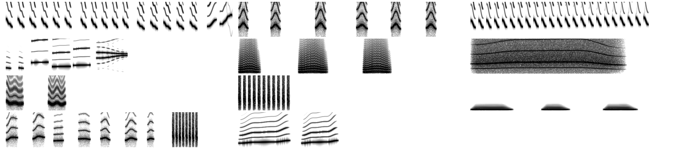

# Bird voice: research for a seeded call synthesizer

This note is the research for adding a small, dependency-free bird-call synthesizer to birddraw. Every seed would get a voice that is as reproducible as its drawing, fits its body (a crow caws low, a warbler trills high), calls at natural irregular intervals, and can drive a beak-gape movement in the idle animation.

Nothing here changes the static drawing. The design follows the same rules as the animation: only local RNG streams (`seed + '#song'`), no geometry regeneration, and the audio loop is periodic in `T`.

A working prototype (about 300 lines, outside the repo) rendered one seed per archetype. Every result was deterministic, landed in its literature frequency band, and cost 0.12–0.28 s of CPU per 6 s loop in Node 24 at 44.1 kHz. Measurements are in section 6.

**Status: implemented.** Method C, the templates and loop-locked timing now live in `birddraw.js` (section "idle animation: voice"). The `sing` movement (off by default) opens the beak, `--format wav` exports the loop, and `index.html` has a **birdsong** toggle, a replay button and a WAV download. `test/sound.js` checks it. Section 8 describes what was built and where it differs from the plan.



*Prototype output, one seed per archetype, 0–10 kHz over 2.2 s. Reading order: finch (trill phrases + flourish), sparrow (cheeps), warbler (fast trill); thrush (intro, three-pitch flute phrase, two-voice ending), corvid (caws with harmonic stacks), raptor (rising-falling hoarse scream); parrot (FM contact calls with AM sidebands), kingfisher (rattle), owl (low hoots); swallow (twitter-warble + rattle), wader (rising "cur-lee" whistles).*

## 1. How a bird makes sound

### The source: the syrinx

Birds phonate with the **syrinx**, at the junction of the trachea and the two bronchi, not with the larynx. Elemans et al. 2015 (*Nat Commun* 6:8978) filmed excised syrinxes from seven species and showed they all use the **myoelastic-aerodynamic (MEAD)** mechanism, the same one human vocal folds use. Expiratory airflow sets paired soft-tissue **labia** into self-sustained oscillation, and a tissue wave travels caudal to cranial along them. Neither muscle contractions at the vibration rate nor a pure aerodynamic whistle is needed.

Two control variables dominate:

- **Air-sac pressure** (expiratory drive) switches phonation on and off and adds amplitude.
- **Labial tension** (from the syringeal muscles) mainly sets the fundamental frequency \(f_0\). Near phonation onset, pressure also changes \(f_0\) (Alliende et al. 2013, *J Neurosci*).

**Two voices.** Songbirds have two independent sound sources, one per bronchus. In most species studied, the **left side sings lower and the right side higher** (Suthers 1990, *Nature* 347:473; Suthers 1997, *J Neurobiol* 33:632). Two examples:

- The Northern Cardinal sings below about 3.5 kHz on the left and 3.5–7 kHz on the right. It switches sides mid-sweep so smoothly that the switch is invisible on a spectrogram.
- Brown thrashers and catbirds run both sides at once with unrelated frequencies. That gives "two-voice" syllables with beating (sum and difference tones, sinusoidal AM) (Suthers, Goller & Hartley 1994, *J Neurobiol* 25).

This is why thrush song sounds chordal, and it is cheap to imitate with a second oscillator (section 5).

**Respiration during song.** All sound is produced on expiration. Between syllables, small birds take **minibreaths**: silent gaps of 15–90 ms in which they inhale about the volume the last syllable used (Hartley & Suthers 1989, *J Comp Physiol A* 165:15; Calder 1970). Minibreaths work up to about **30 syllables/s**. Above that, canaries switch to **pulsatile expiration**, with no inhalation between notes.

This has two consequences:

- **Synthesis:** syllable rates above about 30 Hz should be rare and short.
- **Animation:** while a bird sings, its normal breathing cycle is suspended and replaced by tiny syllable-locked pulses.

### The filter: trachea, oropharynx, beak

The syrinx source is rich in harmonics, but most songbird song is close to a pure tone. Three findings explain why the vocal tract is an **active, tracking filter**:

- **Helium (Nowicki 1987, *Nature* 325:53).** In heliox the speed of sound rises from 331 to 578 m/s, so tract resonances shift up by about 74%. Songbirds singing in heliox suddenly showed a second harmonic. In air, second harmonics are suppressed **whatever their absolute frequency**, so the filter must be retuned note by note.
- **Oropharyngeal-oesophageal cavity, OEC (Riede et al. 2006, *PNAS* 103:5543; Fletcher, Riede & Suthers 2006, *JASA*).** Cardinals inflate the cranial oesophagus behind the tongue and vent it through the beak, which makes a Helmholtz resonator whose peak **tracks \(f_0\)**. A big cavity serves low notes; below about 2 kHz the hyoid spreads the oesophagus. Above about 4 kHz the oesophagus collapses and **beak gape** takes over. Holding a cardinal's beak open raises the 2nd and 3rd harmonics by about 20 dB when \(f_0 < 3\) kHz.
- **Ring-dove and similar cases (Beckers et al. 2003, *PNAS* 100:7372).** Pure tones also come from resonance filtering of harmonic overtones.

**Trachea.** A trachea of length \(L\) acts as a tube closed at the syrinx end and open at the beak, with resonances

\[ f_n = \frac{(2n-1)\,c}{4L}, \qquad c \approx 343 \text{ m/s}. \]

Tracheal length scales with body mass as \(L = 16.77\,M^{0.394}\) cm (M in kg; Hinds & Calder 1971, *Evolution* 25:429). For a 15 g zebra finch this predicts 3.2 cm; the measured value is 3.3–3.5 cm. That puts \(f_1 \approx 2.5\) kHz and \(f_2 \approx 7\) kHz, which are exactly the resonances Amador et al. 2013 fitted for zebra finch song.

### Beak gape tracks pitch

Westneat et al. 1993 (*J Exp Biol* 182:147) filmed singing sparrows:

| species | note frequency | beak gape |
|---|---|---|
| White-throated Sparrow | 3 kHz | 0.4 cm (≈15°) |
| White-throated Sparrow | 4 kHz | 0.7 cm (≈30°) |
| Swamp Sparrow | 3 kHz | 0.2–0.3 cm (10–15°) |
| Swamp Sparrow | 7–8 kHz | > 1 cm (> 50°) |

Gape correlates poorly with amplitude. In zebra finches, the beak "is opened quickly and to its widest aperture **immediately prior to the onset of sound** and at rapid transitions" (Goller et al. 2004, *J Neurobiol* 59:289). Gape shortens the effective tract, which raises its resonance. Hoese et al. 2000 (*J Exp Biol* 203:1845) confirmed this by holding beaks fixed.

For birddraw this gives a physically grounded **visual** channel: the lower mandible should open slightly *before* each note, and open further for higher notes.

### Nonlinear phenomena (harsh calls)

A syrinx driven near its bifurcations can produce:

- **period doubling and subharmonics**, which add energy at \(f_0/2\) between the harmonics;
- **biphonation**, two unrelated frequencies;
- **deterministic chaos**, which sounds like noise but comes from the oscillator itself.

Fee et al. 1998 (*Nature* 395:67) proposed such state transitions in zebra finch song. A 2025 review ("Transitions and tricks", *Phil Trans R Soc B*, doi:10.1098/rstb.2024.0007) notes that topological analysis of 130 adult zebra finches found real period doubling in only one call (Elemans et al. 2010, *J Neurosci* 30:13246). Adult song tends to **avoid** these regimes. They do belong in **calls**: corvid "rough" caws, raptor screams, parrot squawks, and begging.

For synthesis, "harshness" should be a per-archetype dial for calls, not a property of song.

## 2. What birds actually say

### Calls versus songs

| | calls | songs |
|---|---|---|
| structure | short (20–300 ms), simple, often one note | hierarchical: notes → syllables → phrases → song (1–3 s typical) → bouts |
| who | every species, both sexes | mainly oscine males; owls, doves, waders have "songs" built from hoots or whistles |
| learning | largely innate (parrots learn calls) | learned in oscines |
| timing | context-driven, irregular | regular rhythm with refractory pauses |

Call categories and their acoustic signatures:

- **Contact calls.** Short, stereotyped, often individually distinctive. Example: the budgerigar contact call is 150–200 ms, strongly frequency-modulated, with energy at 2–4 kHz and prominent AM (Dooling; Brittan-Powell et al. 1997, *JASA*, doi:10.1121/1.418121; Banta Lavenex 1999, *JASA* 106:491).
- **Aerial-predator alarm, "seet".** A narrow-band, nearly constant tone of about 7–8 kHz with soft onset and offset, which makes it hard to localise (Marler 1955, *Nature* 176:6).
- **Mobbing calls, "chink".** Short, abrupt, broadband, repeated, and easy to localise. The chaffinch chink spans about 3 kHz. Only about half of passerines have truly brief broadband mobbing calls (Ficken & Popp, *Auk*, doi:10.2307/4088904).
- **Flight calls and begging.** Not needed for a perched idle bird.

For an idle perched bird the believable repertoire is: **song** (passerine archetypes), plus occasional **contact calls**, plus for non-passerines their signature call (caw, scream, hoot, rattle, squawk, whistle).

### Song syntax and pacing

**Chaffinch, the canonical example.**

- A song is 2.0–2.5 s long: one to four **trill phrases** of repeated syllables, then a non-repeated **terminal flourish** (Thorpe 1958, *Ibis*; Riebel PhD thesis, St Andrews).
- Trill rate is 8.0 ± 3.0 syllables/s.
- Inter-song silence is about 8–20 s, giving **4.7–7.1 songs/min** at peak season (*Nature* 183:129, 1959).
- Each song type is repeated several times before switching. This is **eventual variety**, as opposed to **immediate variety**, where every song differs (Riebel & Slater 2000, *Anim Behav* 59:1135).

**Hartshorne's monotony threshold (1956, *Auk* 73:176).** Birds that repeat one song pause much longer than the song. Discontinuous singers fill less than 30% of the time with sound, so pauses are at least about 2⅓× the song length. Typical figures are 3.5–7 s pauses after 1.5–3 s songs. Versatile singers such as mockingbirds and many thrushes and wrens use short pauses instead. This gives a usable rule for "random intervals": a **refractory minimum** proportional to the song length, plus a random part.

### Performance limit: beaks constrain trills

Across 34 emberizid species, trill bandwidth and repetition rate fall inside a triangle. Fast trills are always narrow-band. The upper-bound regression (Podos 1997, *Evolution* 51:537) is

\[ \text{BW}_{\max}\,[\text{kHz}] = 7.55 - 0.124 \cdot \text{rate}\,[\text{Hz}], \qquad R^2 = 0.894. \]

Darwin's finches with larger, deeper beaks sing slower, narrower trills (Podos 2001, *Nature* 409:185). The same holds in woodcreepers (Derryberry et al. 2012, *Evolution*), which have a parallel bound \(y = -0.0997x + 4.6\). Wilson et al. 2014 (*Am Nat*, doi:10.1086/674379) warn that binned upper-bound fits are biased by sampling, but the qualitative constraint stands.

This links the drawing's `beak_depth` × `beak_len` to how fast and how wide its trills can be.

## 3. Scaling sound to the drawn bird

### Body mass → pitch

Wallschläger 1980 (*Experientia* 36:412) measured the song centre frequency of 90 European passerines, from the 5.3 g firecrest to the 1400 g raven:

\[ f_c\,[\text{kHz}] = 7.204\,W^{-0.24}, \qquad W \text{ in g}. \]

The exponent is close to that of heart and respiration rate. Ryan & Brenowitz 1985 (*Am Nat* 126:87) and Bradbury & Vehrencamp (\(f \propto M^{-1/3}\)) agree in direction.

The largest analysis, 5,085 passerine species (Mikula et al. 2021, *Ecol Lett*), finds:

- mass explains about 27% of peak-frequency variance raw, and 10–16% after phylogenetic control;
- phylogeny plus mass explain about 70%;
- habitat explains nothing.

Mass is therefore the right first-order driver, and archetype (a proxy for phylogeny) is the right second-order one.

The table below applies these laws to the masses already in `TEMPERAMENT`. "f₁" is the first tracheal quarter-wave resonance from Hinds & Calder. "Breaths/min" is the existing animation's rate, shown for comparison.

| archetype | mass | Wallschläger \(f_c\) | trachea | f₁ / f₂ | literature target | breaths/min |
|---|---|---|---|---|---|---|
| finch | 25 g | 3.33 kHz | 3.9 cm | 2.19 / 6.56 kHz | chaffinch song 2–7 kHz | 54 |
| sparrow | 30 g | 3.18 | 4.2 | 2.04 / 6.11 | house sparrow chirps 1–5 kHz | 51 |
| warbler | 10 g | 4.15 | 2.7 | 3.14 / 9.42 | trills 4–8 kHz, seets to 10 kHz | 72 |
| thrush | 80 g | 2.52 | 6.2 | 1.38 / 4.15 | wood thrush 1.6–8.9 kHz, flute phrases 1.8–4 kHz | 38 |
| corvid | 400 g | 1.71 | 11.7 | 0.73 / 2.20 | crow caw: harmonic stack to 6–7 kHz, energy in 2nd harmonic; raven \(f_c\) 1.25 kHz | 23 |
| raptor | 800 g | 1.45 | 15.4 | 0.56 / 1.67 | red-tailed hawk scream ≈2–3.5 kHz *(non-passerine, off the law)* | 18 |
| parrot | 300 g | 1.83 | 10.4 | 0.82 / 2.47 | budgerigar 2–4 kHz; large parrots lower and harsher | 25 |
| kingfisher | 40 g | 2.97 | 4.7 | 1.82 / 5.45 | belted rattle: broadband pulses < 8 kHz; common kingfisher whistle 4.9–6.6 kHz | 47 |
| owl | 400 g | 1.71 | 11.7 | 0.73 / 2.20 | great horned 0.3–0.4 kHz, tawny ≈0.9 kHz, screech-owl trill ≈0.62 kHz *(far below the law)* | 23 |
| swallow | 20 g | 3.51 | 3.6 | 2.39 / 7.17 | barn swallow 2–7 kHz; warble peak 3.96 kHz, rattle peak 5.42 kHz | 58 |
| wader | 100 g | 2.39 | 6.8 | 1.27 / 3.80 | curlew "cur-lee" 1.7–2.9 kHz, first note ≈1.9–2.2 kHz | 35 |

The passerine law lands inside the observed bands for every passerine archetype. Non-passerines need a per-archetype multiplier: owl ×0.25–0.55, raptor ×1.3–2. These are judgement calls, kept in one table so `tools/build_tables.js` can later refit them from a song database.

### Beak → trill performance

Map beak size to a "vocal deviation" from the Podos bound. Large deep beaks (finch- or parrot-like) get slower maximum trill rates and narrower sweeps. Thin beaks (warblers) can reach the corner of the triangle. The prototype uses:

```js
let dev = clamp((arg.beak_depth*arg.beak_len - 0.3)*2.5, 0, 1.5);
let rate_max = 30 - 8*dev;                                     // Hz
let bw = rate => Math.max(300, (7.55 - 0.124*rate - 1.2*dev)*1000); // Hz
```

### Other drawable cues worth reusing

- `archetype_mix`: blend the pitch multiplier and tempo the same way `anim_params` blends temperament, and pick the call template from the dominant parent.
- `ap.mass`: already jittered ±20% on the `#anim` stream, so voice pitch and breathing rate stay consistent.
- `crest`, `face_*`: no evidence links these to voice. Do not use them.

## 4. Archetype call templates

Each template generates one **utterance** from the bird's centre frequency \(F\) and a local RNG. Durations and rates are from the sources above; anything marked *(judgement)* is a tuning choice.

| archetype | utterance | key numbers |
|---|---|---|
| finch | 2–3 trill phrases of downswept syllables, each phrase a little lower, then a 2-note flourish | rate 6–11 Hz (Podos-capped), syllable ≈55% of the period, phrase 3–7 reps, song ≈2–2.5 s |
| sparrow | series of "cheeps": chevron FM, moderately harmonic | 70–130 ms notes, 2–4 per s, 3–8 per series |
| warbler | single fast trill with a slow pitch ramp | 11–20 Hz, 12–26 syllables, nearly pure tone |
| thrush | 2 soft intro notes, a three-pitch flute phrase, a two-voice terminal trill | phrase notes 120–200 ms; pitch orders 231/132/213/312 (Wood Thrush, 231 > 50%); second voice at an unrelated ratio (≈1.36×) with 18–30 Hz AM |
| corvid | bout of 2–6 caws with a chevron contour | \(f_0 \approx 0.36F\) (≈600 Hz), formant at \(2f_0\), 200–360 ms caws, inter-call < 400 ms, bouts 1.5–3 s apart; 35–60 Hz "wobble" FM (Laiolo & Rolando), roughness and a weak subharmonic |
| raptor | one hoarse rise-plateau-fall scream, falling about a fourth (×0.75) | real 2–3 s, shortened to 1–1.8 s for a 6 s loop *(judgement)* |
| parrot | 1–2 contact calls with 4–5 random FM control points | 150–220 ms, 150–400 Hz AM sidebands |
| kingfisher | dry rattle of broadband noise pulses, decaying | 14–24 pulses/s *(judgement; Davis 1986, Condor 88:505 gives spectra, not a rate)*, 0.5–1 s |
| owl | 2–5 low hoots, the last with a slight vibrato | \(f_0 \approx 0.25F\), first hoot 0.3–0.5 s, soft 60 ms attack |
| swallow | twitter-warble of random FM syllables, then a rattle | warble 4.6 syll/s, rattle 31 pulses/s with peak above the warble |
| wader | 1–3 rising "cur-lee" whistles with an upward flick | 0.3–0.55 s each, ≈0.6 s apart |

Contact calls (one short note per archetype) can be mixed in at a low rate between songs for passerines, using the same machinery.

## 5. Synthesis methods compared

### A. Physical model: Mindlin–Amador normal form

Gardner et al. 2001 (*PRL* 87:208101) showed that canary song arises from smooth pressure and tension gestures driving a labial oscillator. The modern minimal form is a Takens–Bogdanov normal form (Sitt et al. 2008; Amador et al. 2013, *Nature* 495:59; review Mindlin 2017, *Chaos* 27:092101):

\[
\dot x = y, \qquad
\dot y = -\alpha\gamma^2 - \beta\gamma^2 x - \gamma^2 x^3 - \gamma x^2 y + \gamma^2 x^2 - \gamma x y
\]

- \(\alpha(t)\) is proportional to air-sac pressure.
- \(\beta(t)\) is proportional to labial tension.
- \(\gamma\) is a time scale; 24000 fits zebra finches.

The tract is a delay-line tube plus a Helmholtz resonator for the OEC:

\[ P_i(t) = \alpha(t)\,x(t) - r\,P_i(t - T_t), \qquad P_{tr}(t) = (1-r)\,P_i(t - T_t/2), \qquad T_t = 2L/c. \]

**Sign convention.** Published versions differ in the signs of \(\alpha\) and \(\beta\). Mindlin 2017 writes \(+\alpha\gamma^2 + \beta\gamma^2 x\). I measured the phonating region for the "−α −β" form above with an RK4 integrator: 44.1 kHz × 20 substeps, \(\gamma = 24000\), starting from \(x = 0.01\). Each cell gives \(f_0\) and the power in harmonics 2–5 relative to the fundamental; "—" means silent.

| α \ β | 0.2 | 0.0 | −0.2 | −0.4 |
|---|---|---|---|---|
| ≤ 0 | — | — | — | — |
| 0.10 | 2.05 kHz / −10 dB | — | — | — |
| 0.20 | 2.66 / −10 | 1.58 / −5 | — | — |
| 0.30 | 3.11 / −11 | 2.44 / −8 | 0.65 / **+2** | — |
| 0.40 | 3.49 / −12 | 2.97 / −9 | 2.12 / −5 | — |
| 0.50 | 3.81 / −12 | 3.39 / −10 | 2.81 / −8 | 1.61 / −2 |
| 0.60 | 4.10 / −13 | 3.75 / −11 | 3.32 / −10 | 2.67 / −7 |

So with this sign convention, phonation needs \(\alpha > 0\). The reason is that negative damping (\(-\gamma x(x+1) > 0\)) needs a fixed point in \(-1 < x^* < 0\). Close to the onset boundary (the saddle-node-in-limit-cycle line), \(f_0\) collapses towards zero and the sound becomes **harmonically rich**, up to +2 to +5 dB. This is the "low notes are spectrally rich" property the model is known for. \(f_0\) scales linearly with \(\gamma\), so \(\gamma\) can be set from body mass.

Cost: **24 ms per second of audio** for the oscillator alone, before the tract model.

| | |
|---|---|
| Pros | Physically meaningful controls; correct coupling of pitch to timbre; harsh regimes for free. |
| Cons | Pitch is an implicit function of (α, β), so each target contour needs an inverse lookup table. It is stiff at high γ, so it needs substeps. Its parameter space is unintuitive to tune for 11 archetypes. Thrush two-voice needs two oscillators plus a mixer. Calls like rattles and squawks are hard to reach. |

### B. Farnell-style FM/AM tweet generator

Andy Farnell's *Designing Sound* (MIT Press 2010; Practical 28 "Birds", ch. 51; Pure Data patches at aspress.co.uk/sd) builds a bird as one sine carrier, frequency-modulated and amplitude-modulated by two envelope-shaped modulators. Each modulator envelope has attack and decay. Fredrik Olofsson's SuperCollider port is about 20 lines:

\[ s(t) = E(t)\,\big(1 - a_2(t)\sin 2\pi m_2 t\big)\,\sin\!\Big(2\pi\!\int\! \big(300 + 7000\,\phi\,(1 + a_1\sin 2\pi m_1 t)\big)\,dt\Big). \]

| | |
|---|---|
| Pros | Tiny and cheap; good for tweets and chirps. |
| Cons | One tonal voice. No formant, so no crow or hawk timbre and no noise for rattles. Parameters are not tied to biology. |

### C. Additive source + Lorentzian formant + noise band (recommended)

A source-filter model specialised for birds, which is what the prototype implements.

**1. Pitch contour.** \(f(u)\), \(u \in [0,1]\), interpolated in log-frequency through a few control points with the existing minimum-jerk profile. Log interpolation keeps glides perceptually even.

**2. Phase accumulator**, which keeps phase continuous through any FM:

\[ \varphi_{n+1} = \varphi_n + 2\pi f_n / f_s \]

**3. Harmonic source.** Spectral tilt \(r\) (0.05 for a flute-like thrush, 0.85 for a crow), shaped by a formant centred at \(f_c\) with bandwidth \(b\):

\[ s_n = \frac{\sum_{k:\,k f_n < 0.45 f_s} r^{k-1}\,L_k \sin(k\varphi_n)}{\sum_k r^{k-1} L_k}, \qquad L_k = \frac{1}{1 + \big((k f_n - f_c)/b\big)^2}. \]

- **Tracking formant**, \(f_c = f_n\), gives the Riede/Nowicki pure tone.
- **Formant at \(2f_0\)** gives the crow caw, whose energy sits in the 2nd harmonic (Tarter 2008).
- The source is **band-limited by construction**: no aliasing and no filter state to blow up.

**4. Roughness.** Low-pass-filtered random FM, \(f \leftarrow f\,(1 + h\,\xi_n)\), where \(\xi\) is one-pole-smoothed white noise at about 250–600 Hz. This spreads each harmonic into a band, which is what hoarse calls look like on a spectrogram.

**5. Subharmonic.** Add \(\sigma \sin(\varphi/2)\) for period-doubling rasp.

**6. Second voice.** An independent contour mixed in with gain \(g\). This is the two-sided syrinx: thrush chords and AM beats.

**7. Noise band.** White noise through a **topology-preserving-transform state-variable filter** (Zavalishin, *The Art of VA Filter Design*), centred on a multiple of \(f\). It stays stable at any centre frequency and with per-sample coefficient changes. Used for rattles, chinks and screams:

\[ g = \tan(\pi f_c/f_s),\; a_1 = \frac{1}{1+g(g+k)},\; a_2 = g a_1,\; a_3 = g a_2;\quad v_3 = x - s_2,\; v_1 = a_1 s_1 + a_2 v_3,\; v_2 = s_2 + a_2 s_1 + a_3 v_3,\; s_1 \leftarrow 2v_1 - s_1,\; s_2 \leftarrow 2v_2 - s_2. \]

The band-pass output is \(v_1\), and \(k = 1/Q\).

**8. Envelopes and AM.** Raised-cosine attack and release (2–80 ms), plus optional sinusoidal AM (budgerigar sidebands) or a pulse train (rattles).

**9. Output.** Soft clip with `tanh` after peak normalisation.

| | |
|---|---|
| Pros | Every parameter maps to a measured quantity in sections 1–4. Covers tonal song, harsh calls, rattles and two-voice in one routine. Deterministic. About 150 lines. |
| Cons | Not a physical model, so pitch–timbre coupling has to be authored per template. In practice that is what the templates already do. |

### D. Rejected options

| option | why not |
|---|---|
| Recorded samples (xeno-canto, Macaulay) | Licensing, file size, and not seedable. |
| Digital waveguide syrinx models | Heavier, and no clear benefit over C for 11 stylised archetypes. |
| Neural vocoders | Dependencies and size. |
| Web Audio node graphs (`OscillatorNode` + `setValueCurveAtTime`) | Only run in browsers, don't render in Node, and can't be hashed deterministically. Use Web Audio only to *play* a buffer rendered in plain JS. |

## 6. Prototype results

The prototype (`song.js`, `spec.js`, `nf.js`; outside the repo) implements method C, the templates in section 4, and the timing in section 7. Results for the first seed of each archetype at \(T = 6\) s, 44.1 kHz:

| archetype | seed | mass | \(F\) | peak | centroid | Wiener entropy | duty | CPU |
|---|---|---|---|---|---|---|---|---|
| finch | Saxlirhynchus pugaatus | 27 g | 3.24 kHz | 3.66 kHz | 3.67 kHz | −12.5 | 24% | 145 ms |
| sparrow | Hyops flaceata | 28 g | 2.95 | 2.89 | 3.00 | −6.8 | 12% | 162 ms |
| warbler | Vies bigaens | 11 g | 4.01 | 4.05 | 4.08 | −12.2 | 20% | 137 ms |
| thrush | Myornis pergaa | 79 g | 2.44 | 3.10 | 3.14 | −17.2 | 15% | 276 ms |
| corvid | Chlocorhynchus auphanoonotus | 395 g | 1.80 | 1.21 | 1.13 | −4.8 | 12% | 236 ms |
| raptor | Sturcodroax erylois | 793 g | 1.82 | 3.19 | 3.29 | −4.5 | 24% | 276 ms |
| parrot | Neniola fuscaans | 295 g | 1.93 | 1.94 | 2.00 | −6.6 | 6% | 174 ms |
| kingfisher | Anda viatus | 41 g | 2.76 | 2.97 | 3.80 | −1.2 | 6% | 126 ms |
| owl | Picaca aloides | 429 g | 0.94 | 0.65 | 0.55 | −18.8 | 16% | 188 ms |
| swallow | Piphiula pucepheus | 192 g* | 2.15 | 2.45 | 2.49 | −9.6 | 16% | 204 ms |
| wader | Phynaops canceps | 109 g | 2.06 | 1.55 | 1.56 | −16.3 | 27% | 205 ms |

\*This seed is a swallow blended with a heavier archetype; `anim_params` interpolates mass.

How to read the columns:

- **Wiener entropy** is the log ratio of the geometric to arithmetic mean of the power spectrum, as defined by Sound Analysis Pro (Tchernichovski et al. 2000). Pure tone → −∞, white noise → 0. It separates tonal song (−12 to −19) from harsh calls (−4.5 to −7) and rattles (−1.2), which is the intended ordering.
- **Duty** is the share of frames with sound. It stays under Hartshorne's 30% for every archetype.
- **Peak frequency** falls in the literature band of section 3 for every archetype.

Determinism and seamlessness:

- Two renders of the same seed are bit-identical.
- The step across the loop seam is 0, against 0.04–0.96 for the largest step inside the loop.

Cost is 2–5% of real time without any optimisation, dominated by `Math.pow` and `Math.sin` per harmonic per sample. Three standard fixes should give several times the speed:

- precompute \(r^{k-1}\);
- generate \(\sin(k\varphi)\) with the Chebyshev recurrence \(\sin k\varphi = 2\cos\varphi\,\sin(k-1)\varphi - \sin(k-2)\varphi\);
- update formant weights every 32 samples.

## 7. Random intervals that still loop

### The timing model

Utterances form a **renewal process**. Gaps between onsets are **gamma-distributed**, \(\Gamma(k, \theta = \mu/k)\), drawn as a sum of \(k\) exponentials from the local RNG.

- \(k = 1\) is Poisson: memoryless, so two calls can land almost back to back. That suits parrots and contact calls.
- \(k = 2\)–\(3\) gives the regular-but-not-metronomic rhythm of territorial song.

Hartshorne's refractory rule bounds each gap from below:

\[ \Delta_i = \max\!\big(3.33\,d_i,\; \Gamma(k, \mu/k)\big) \]

where \(d_i\) is the utterance length. This keeps singing under 30% of the time.

Starting values *(judgement, informed by the rates above)*:

| archetype | mean gap \(\mu\) | shape \(k\) |
|---|---|---|
| finch | 9 s | 3 |
| sparrow | 4 s | 2 |
| warbler | 7 s | 3 |
| thrush | 6 s | 3 |
| corvid | 5 s | 2 |
| raptor | 12 s | 2 |
| parrot | 3 s | 1.5 |
| kingfisher | 8 s | 2 |
| owl | 10 s | 3 |
| swallow | 5 s | 2 |
| wader | 6 s | 2 |

The chaffinch figures (2.2 s songs, 4.7–7 songs/min) imply a mean gap of about 9–13 s.

### Loop-locked mode (default, matches `AGENTS.md`)

All events live in \([0, T)\) and use the same patterns as blinks and tail flicks in `make_timeline`:

- The **first onset** is drawn uniformly in \([0, T/2)\), so every loop has **at least one utterance**. This mirrors the "at least one head move" rule for owls.
- Later onsets follow the renewal process. An utterance is kept only if its end, wrapped modulo \(T\), stays 0.2 s clear of the first onset, so nothing overlaps across the seam.
- Samples are written to `out[(i0 + i) % N]` with \(N = \text{round}(T f_s)\). A tail that crosses the end wraps additively into the start, which makes the buffer exactly periodic. Played with `AudioBufferSourceNode.loop = true`, it loops sample-accurately.

**Loop length matters.** With the default \(T = 6\) s, a chaffinch (2.2 s song, ≥7.3 s pause) can fit only one song per loop. Over many loops that exact repetition becomes noticeable. Two options:

1. Suggest `--duration 12`–`20` when sound is on.
2. When \(3.33\,d > T\), fall back from full song to the archetype's contact call.

### Ambient mode (live page only, optional)

For a page left open, exact repetition every 6 s is the least natural part. An ambient scheduler avoids it:

- Run the renewal process on absolute time: \(t_k = t_{k-1} + \Delta_k\).
- Seed each utterance from its own stream, `make_rng(seed + '#song#' + k)`. Utterance \(k\) is then the same whenever you listen, but the sequence never repeats.
- Schedule each utterance's buffer on the `AudioContext` clock a second or two ahead, using the "two clocks" lookahead pattern (Chris Wilson, web.dev "A tale of two clocks").

This deliberately breaks "periodic in \(T\)" for **audio only**. Exports (WAV, GIF, flipbook) stay loop-locked. The beak gape would then read absolute song time, not \(t \bmod T\).

### Variety within a seed

To give a seed a small **repertoire** with eventual variety:

- Draw 2–3 song "types" from `#song` once: phrase count, syllable contour, rate.
- Repeat one type for 3–6 utterances before switching (Riebel & Slater).
- Jitter only micro-parameters per rendition: pitch ±3%, repeat count ±1, timing ±5%.

Thrush archetypes can use **immediate variety** instead, because versatile singers switch types every song.

## 8. Integration in birddraw

### Seeds and streams

| stream | drives |
|---|---|
| `seed + '#song'` | voice parameters (pitch jitter, which parent's template a blended bird uses) and the event schedule |
| `seed + '#songnoise'` | sample-level noise only (roughness jitter, noise bands, random phases), so changing synthesis detail never moves event times |
| no new streams | `generate_params()` and `jsr`/`rand()` are untouched, so `main(seed)` stays byte-identical and the static golden hashes cannot move |

The voice reads only values that already exist after `generate_params()`. `anim_params` now also carries `mix` (`arg.archetype_mix`) and `beak_size` (`arg.beak_depth * arg.beak_len`) without drawing from its RNG, next to `ap.mass`. Pitch and breathing rate therefore come from the same mass.

### Code

```js
let ANIM_MOVES = {breath:true, head:true, blink:true, tail:true, crest:true, wing:false, flap:false, sing:false};
let VOICE = {finch: {pitch:1, gap:9, k:3, gape:1}, owl: {pitch:0.55, gap:10, k:3, gape:0.25}, /* ... */};
let VOX = {finch(F,r,t,V){ /* [{t, n:{dur, f:[...], ...}}] */ }, /* one template per archetype */};

voice_params(ap, seed)   // F = 7204 * mass^-0.24 * pitch * tri(0.85,1,1.15); Podos limits from beak_size
make_song(V, T)          // {T, seed, an, F, utts:[{t0,t1,n}], notes:[{t,dur,f,...,gape}], gape_at(t)}
render_song(song, sr)    // Float32Array of round(T*sr), peak-normalised, tanh soft clip
wav_encode(pcm, sr)      // Uint8Array: 44-byte RIFF header + PCM16 mono (no Buffer, works in browsers)
```

- **Always scheduled.** `make_timeline` builds `song` for every animator, unlike the plan. Scheduling costs under 1 ms, and audio export then works whether or not the `sing` movement is on; `sing` only adds the beak gape. `animator()` exposes `song` and `audio(sr)`.
- **Faster than the prototype.** Harmonics use the Chebyshev recurrence \(\sin k\varphi = 2\cos\varphi\,\sin(k-1)\varphi - \sin(k-2)\varphi\) instead of one `Math.sin` per partial. A 6 s loop at 44.1 kHz renders in 10–70 ms in Node, against 120–280 ms for the prototype.
- **CLI.** `--format wav` honours `--duration`, `--out` and `--rate` (default 44100). It writes with `fs.writeFileSync` when `--out` is given, because PowerShell 5 `>` corrupts binary output.

### `index.html`

- **Controls.** One **birdsong** checkbox, with **replay** and **download wav** buttons, sits next to the drawing controls; **singing** is in the movement list.
  - Not alive: each newly drawn bird plays its first utterance once (`voice(seed).clip(sr)`, no rig needed). Replay plays it again and download saves it.
  - Alive: the full loop plays, locked to the animation, and singing is ticked. Replay restarts the loop and download saves it.
- **Autoplay.** The `AudioContext` is created or resumed inside that click handler, to satisfy the autoplay policy.
- **Rendering.** The loop is rendered once per bird at `ctx.sampleRate`, so no resampling is needed. It plays from an `AudioBufferSourceNode` with `loop = true`.
- **Sync.** While the context is running, the canvas time comes from the audio clock:

```js
let t = actx.currentTime - live.a0 - (actx.outputLatency || 0);
t = ((t % live.T) + live.T) % live.T;
```

- **Fallback.** Otherwise it falls back to `performance.now()`, so a suspended context can't freeze the picture. Turning sound off carries the phase over to the wall clock.

### The singing pose: beak gape

`gape` (radians) is **appended last** in both `pose_at` and `rest_pose`, so the two objects keep the same shape.

**Gape curve.** Each note gets a fixed angle from its geometric-mean pitch \(\bar f\) relative to the bird's centre pitch \(F\). Higher notes open wider, after Westneat 1993:

\[ \theta = 30° \cdot g_{\text{arch}} \cdot \left(0.4 + 0.6\,\text{clamp}\!\left(\frac{\bar f/F - 0.6}{1.2},\,0,\,1\right)\right) \]

- The 0.4 floor replaces the planned `clamp(…, 0.15, 1)`. With the plan's form, a crow's caw (\(\bar f \approx 0.36F\)) would barely open the beak.
- The archetype factor \(g_{\text{arch}}\) runs from 0.25 (owl) to 2 (corvid).
- The envelope opens with minimum jerk **30 ms before** the note (Goller 2004), holds, and closes over 80 ms. Overlapping notes take the maximum, so fast trills hold the beak open instead of chattering.
- The timing is wrapped in \(T\).
- Measured maxima on the pure-archetype test seeds: owl 3°, parrot 15°, wader 16°, warbler 17°, sparrow 18°, kingfisher 22°, finch and swallow 23°, corvid 24°, thrush 30°, raptor 35°.

**Geometry.** This differs from the plan in three ways:

- **Line selection by index.** `beak()` records which of its lines belong to the lower mandible: `lower` plus the lower fill or shading. It does this by array index, around the existing `fill_shape`/`shade_shape` calls, rather than with `pt_in_poly`. No `rand()` call moves. The rest goes on the part as `p.jaw = {pivot, idx, upper, lower, tomium_l, mouth}`. `mouth` is the upper cutting edge over the lower jaw's length.
- **Separate group.** With `sing` on, `anim_rig` splits the beak into `beak` (head group, masked by `upper_poly`) and `jaw` (its own `jaw` group, right behind it). A separate group rather than a head sub-group keeps the head's one-off pre-clip valid. The open mandible is clipped per frame like any other cross-group part.
- **Per-frame mask.** Each frame, the jaw's lines are rotated by \(-\theta\) about `P(u0, mid(u0))` and then pass through the head map. The beak points along −x, so a negative angle opens downward. The jaw mask is `mouth` plus the rotated lower outline, which paints out the mouth interior. The lower cutting edge (`tomium_l`) is added as a dynamic line while the beak is open. It starts one sample past the hinge, because the hinge lies exactly on the upper mask's boundary and would flip the clipper's inside/outside parity.

**Not done yet** (from the plan):

- breath damping and minibreath pulses while singing;
- the cranial-kinesis upper-jaw lift;
- head pitch-up during song;
- throat puffing for owls.

### Output formats

- **WAV.** RIFF/PCM16 mono needs a 44-byte header and is trivial.
- **GIF and flipbook SVG** cannot carry sound. A video needs external muxing, which is out of scope for a zero-dependency repo.
- **SVG.** SMIL audio inside SVG is not supported reliably. Keep audio as a sibling file named `<seed>_alive.wav`.

## 9. Testing

`test/sound.js` (part of `npm test`) runs the unmixed seed of each archetype plus 12 named seeds:

- **Static golden unchanged.** `test/static_golden.js` still passes untouched. This is the proof that no global `rand()` was added.
- **Determinism.** The note schedule and the PCM are identical across two independent builds in one process.

  PCM is deliberately not golden-hashed across Node or browser versions. ECMAScript leaves `Math.sin`, `Math.tan`, `Math.exp` and `Math.pow` implementation-approximated, so the last bits can differ between engines, and unlike the polyline output, audio is not truncated to 4 decimals.
- **Schedule.** Every check here passes:
  - at least one utterance per loop;
  - onsets lie in \([0, T)\);
  - no utterance overlaps the next, including across the seam;
  - the voice sounds for at most 60% of the loop.
- **Seamless audio.** The step at `out[N-1] → out[0]` is no larger than the largest interior step, the peak lies in (0.1, 0.8], and every sample is finite.
- **Acoustics** of the unmixed archetypes, measured at 44.1 kHz with 1024-point frames:
  - median spectral peak inside a per-archetype band;
  - Wiener entropy below −9 for finch, warbler, thrush, owl and wader;
  - Wiener entropy above −8 for corvid, raptor and kingfisher.
- **Independence.** Turning on `sing` changes no pose channel except `gape`, and `gape` is 0 without it. `pose_at` and `rest_pose` have the same field order.
- **Gape:**
  - between 2° and 40° at its widest;
  - continuous across the seam;
  - shut between utterances that are more than 0.3 s apart.
- **Gape rendering:**
  - in frame at full gape;
  - painter matches exact to within 0.5% (measured worst 0.11%);
  - the closed singing rig matches the static drawing to within 0.5% (measured 0.04%).
- **WAV bytes.** Chunk tags, sizes, sample rate and PCM16 rounding and clipping are correct.
- **Performance budget.** A 6 s loop at 44.1 kHz renders in under 250 ms (measured worst 70 ms).

## 10. Open choices

Decided: method C, `sing` off by default, loop-locked timing, and the 6 s default loop. A first utterance that doesn't fit the loop is trimmed to the notes that do; if none fit, its first note is shortened to at most \(0.6T\).

Still open:

1. The physical normal form (method A) could later replace the source stage of C for passerine song only.
2. Ambient (non-loop-locked) mode in the live page.
3. **Judgement values to revisit:**
   - non-passerine pitch multipliers;
   - kingfisher rattle rate;
   - raptor scream shortening;
   - gap means;
   - gape factors.

## References

**Production mechanics**
- Elemans CPH et al. 2015. Universal mechanisms of sound production and control in birds and mammals. *Nat Commun* 6:8978. doi:10.1038/ncomms9978
- Gardner T, Cecchi G, Magnasco M, Laje R, Mindlin GB. 2001. Simple motor gestures for birdsongs. *PRL* 87:208101.
- Amador A, Perl YS, Mindlin GB, Margoliash D. 2013. Elemental gesture dynamics are encoded by song premotor cortical neurons. *Nature* 495:59–64. doi:10.1038/nature11967
- Mindlin GB. 2017. Nonlinear dynamics in the study of birdsong. *Chaos* 27:092101 (PMC5605333).
- Alliende J et al. 2013. A mechanism for frequency modulation in songbirds shared with humans. *J Neurosci*. doi:10.1523/JNEUROSCI.5906-12.2013
- Suthers RA. 1990. Contributions to birdsong from the left and right sides of the intact syrinx. *Nature* 347:473.
- Suthers RA, Goller F, Hartley RS. 1994. Motor dynamics of song production by mimic thrushes. *J Neurobiol* 25. doi:10.1002/neu.480250803
- Suthers RA. 1997. Peripheral control and lateralization of birdsong. *J Neurobiol* 33:632–652.
- Calder WA. 1970. Respiration during song in the canary. *Comp Biochem Physiol* 32:251.
- Hartley RS, Suthers RA. 1989. Airflow and pressure during canary song: direct evidence for mini-breaths. *J Comp Physiol A* 165:15.

**Vocal tract and beak**
- Nowicki S. 1987. Vocal tract resonances in oscine bird sound production: evidence from birdsongs in a helium atmosphere. *Nature* 325:53.
- Riede T, Suthers RA, Fletcher NH, Blevins WE. 2006. Songbirds tune their vocal tract to the fundamental frequency of their song. *PNAS* 103:5543.
- Fletcher NH, Riede T, Suthers RA. 2006. Model for vocalization by a bird with distensible vocal cavity and open beak. *JASA*. doi:10.1121/1.2159434
- Beckers GJL, Suthers RA, ten Cate C. 2003. Pure-tone birdsong by resonance filtering of harmonic overtones. *PNAS* 100:7372.
- Westneat MW, Long JH, Hoese W, Nowicki S. 1993. Kinematics of birdsong. *J Exp Biol* 182:147.
- Hoese WJ, Podos J, Boetticher NC, Nowicki S. 2000. Vocal tract function in birdsong production. *J Exp Biol* 203:1845.
- Goller F, Mallinckrodt MJ, Torti SD. 2004. Beak gape dynamics during song in the zebra finch. *J Neurobiol* 59:289.
- Daley M, Goller F. 2004. Tracheal length changes during zebra finch song. *J Neurobiol* 59:319.
- Hinds DS, Calder WA. 1971. Tracheal dead space in the respiration of birds. *Evolution* 25:429.

**Nonlinear phenomena**
- Fee MS, Shraiman B, Pesaran B, Mitra PP. 1998. The role of nonlinear dynamics of the syrinx in the vocalizations of a songbird. *Nature* 395:67.
- Elemans CPH, Laje R, Mindlin GB, Goller F. 2010. Smooth operator: avoidance of subharmonic bifurcations through mechanical mechanisms simplifies song motor control in adult zebra finches. *J Neurosci* 30:13246.
- Transitions and tricks: nonlinear phenomena in the avian voice. 2025. *Phil Trans R Soc B* 380. doi:10.1098/rstb.2024.0007

**Scaling and performance**
- Wallschläger D. 1980. Correlation of song frequency and body weight in passerine birds. *Experientia* 36:412.
- Ryan MJ, Brenowitz EA. 1985. The role of body size, phylogeny, and ambient noise in the evolution of bird song. *Am Nat* 126:87.
- Mikula P et al. 2021. A global analysis of song frequency in passerines… *Ecol Lett*. doi:10.1111/ele.13662
- Podos J. 1997. A performance constraint on the evolution of trilled vocalizations in a songbird family. *Evolution* 51:537.
- Podos J. 2001. Correlated evolution of morphology and vocal signal structure in Darwin's finches. *Nature* 409:185.
- Derryberry EP et al. 2012. Correlated evolution of beak morphology and song in the Neotropical woodcreeper radiation. *Evolution*. doi:10.1111/j.1558-5646.2012.01642.x
- Wilson DR et al. 2014. Uneven sampling and the analysis of vocal performance constraints. *Am Nat*. doi:10.1086/674379

**Song structure and calls**
- Hartshorne C. 1956. The monotony-threshold in singing birds. *Auk* 73:176.
- Thorpe WH. 1958. The learning of song patterns by birds, with especial reference to the song of the chaffinch. *Ibis*. doi:10.1111/j.1474-919X.1958.tb07960.x
- Singing pattern of the common chaffinch. 1959. *Nature* 183:129. doi:10.1038/183129a0
- Riebel K, Slater PJB. 2000. Testing the flexibility of song type bout duration in the chaffinch. *Anim Behav* 59:1135.
- Marler P. 1955. Characteristics of some animal calls. *Nature* 176:6.
- Ficken MS, Popp J. A comparative analysis of passerine mobbing calls. *Auk*. doi:10.2307/4088904

**Per-archetype acoustics**
- Tarter RR. 2008. The vocal behavior of the American crow. MSc thesis, Ohio State.
- Mates EA et al. Acoustic profiling in a complexly social species, the American crow (PMC4237024).
- Galeotti P et al. 1996. Macro and microgeographical variations in the hoot of Italian and English tawny owls. *Ital J Zool*.
- Great Horned Owl *Bubo virginianus* vocalizations and associated behaviours. *Ardea* 97. doi:10.5253/078.097.0403
- The antipredator vocalizations of adult Eastern Screech-Owls. doi:10.5281/zenodo.16278277
- Davis WJ. 1986. Acoustic recognition in the Belted Kingfisher. *Condor* 88:505.
- Birds of the World accounts: Barn Swallow (sounds), Red-tailed Hawk (sounds).
- Brittan-Powell EF et al. 1997. Mechanisms of vocal production in budgerigars. *JASA*. doi:10.1121/1.418121
- Banta Lavenex P. 1999. Vocal production mechanisms in the budgerigar: the presence and implications of amplitude modulation. *JASA* 106:491.
- The Sound Approach: Eurasian Curlew.
- Vocal gymnastics in Wood Thrush songs (*Ohio J Sci*, hdl:1811/4362).
- The songs and calls of the Wood Thrush (*Auk*).

**Synthesis, analysis and playback**
- Farnell A. 2010. *Designing Sound*. MIT Press. Practical 28 "Birds" (ch. 51); patches at aspress.co.uk/sd.
- Zavalishin V. *The Art of VA Filter Design* (TPT state-variable filter).
- Tchernichovski O et al. 2000. A procedure for an automated measurement of song similarity. *Anim Behav* 59 (Sound Analysis Pro; Wiener entropy definition at soundanalysispro.com).
- MDN: Web Audio API best practices (autoplay); `AudioContext.outputLatency`.
- Wilson C. 2013. A tale of two clocks. web.dev.
